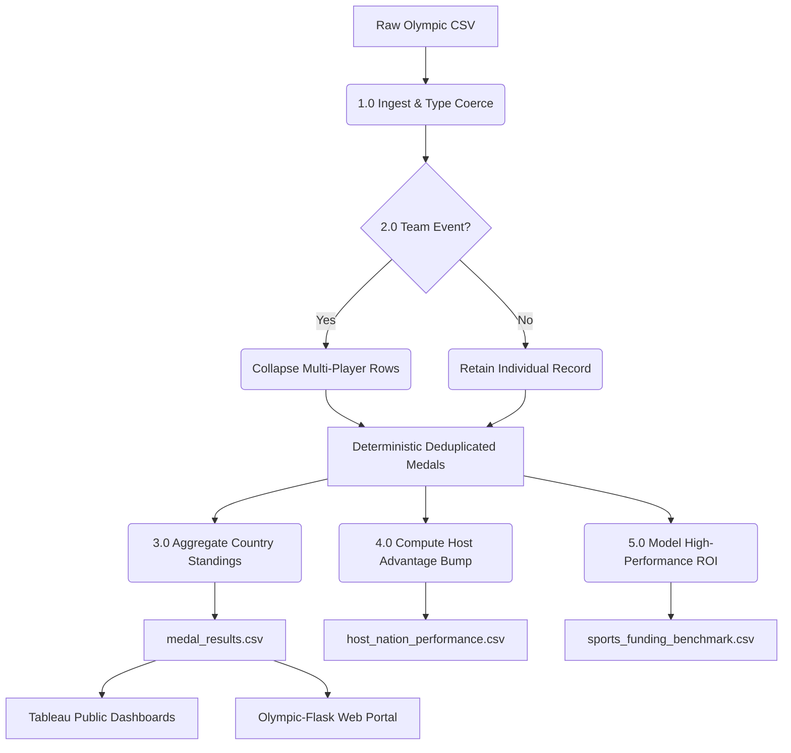
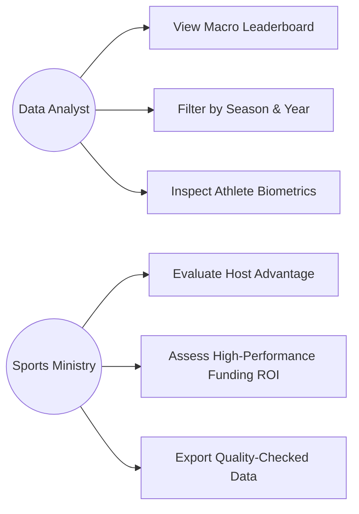

# Data Flow Diagrams (DFD) & UML Specifications
## Global Olympic Sports Performance Analysis

---

## 1. DFD Level 0 (Context Diagram)

```
                       ┌─────────────────────────┐
                       │  IOC Historical Source  │
                       └─────────────────────────┘
                                    │
                                    │ Raw Competition Records
                                    ▼
┌──────────────┐       ┌─────────────────────────┐       ┌──────────────────┐
│              │       │                         │       │                  │
│ Public /     │ <───> │  Olympic Analytics      │ <───> │ Sports Ministry  │
│ Researcher   │       │  Platform Pipeline      │       │ Analysts         │
│              │       │                         │       │                  │
└──────────────┘       └─────────────────────────┘       └──────────────────┘
                                    │
                                    ▼
                       ┌─────────────────────────┐
                       │  Tableau Public Cloud   │
                       └─────────────────────────┘
```

---

## 2. DFD Level 1 (Decomposition Diagram)



---

## 3. UML Use Case Diagram



