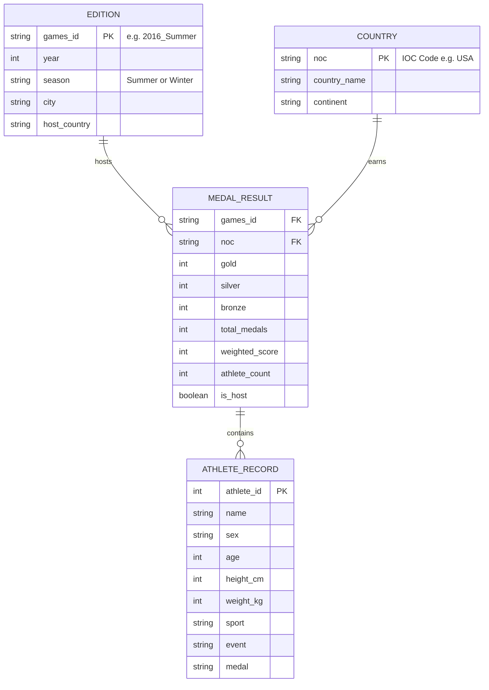

# Phase 3: Project Design Phase
## System Architecture, Data Flow & Visual Wireframes

---

## 🏛️ 1. System Architecture

The project is structured around a decoupled **3-Tier Data Analytics Architecture**:

```
+--------------------------------------------------------------------------+
|                        TIER 1: DATA INGESTION & STORAGE                  |
|                                                                          |
|   [Raw IOC Historical Archives]        [NOC Territorial Regional Standards]
|                  │                                     │                 |
|                  ▼                                     ▼                 |
|       olympics_raw.csv (35.9 MB)              noc_regions_raw.csv        |
+--------------------------------------------------------------------------+
                                     │
                                     ▼
+--------------------------------------------------------------------------+
|                        TIER 2: PROCESSING & BUSINESS LOGIC               |
|                                                                          |
|   ┌───────────────────────────┐         ┌────────────────────────────┐   |
|   │     src/clean_data.py     │ ──────> │       src/analyze.py       │   |
|   │  - Deduplication Engine   │         │  - Statistical Modeling    │   |
|   │  - GitHub <25MB Coercion  │         │  - Host Nation Surge Check │   |
|   │  - ISO/NOC Standardization│         │  - Capital ROI Correlation │   |
|   └───────────────────────────┘         └────────────────────────────┘   |
|                  │                                     │                 |
|                  ▼                                     ▼                 |
|        athletes.csv (22.78 MB)               analysis_summary.json       |
|        medal_results.csv (301 KB)            host_nation_performance.csv|
+--------------------------------------------------------------------------+
                                     │
                                     ▼
+--------------------------------------------------------------------------+
|                        TIER 3: PRESENTATION & USER INTERACTION           |
|                                                                          |
|   ┌──────────────────────────┐    ┌──────────────────────────┐           |
|   │      Tableau Public      │    │    Olympic-Flask App     │           |
|   │  - Global Performance    │    │  - Responsive Web UI     │           |
|   │  - Regional Efficiency   │    │  - Dynamic Search/Filter │           |
|   │  - Interactive Slicers   │    │  - REST JSON Endpoints   │           |
|   └──────────────────────────┘    └──────────────────────────┘           |
+--------------------------------------------------------------------------+
```

---

## 🔄 2. Data Flow Diagram (DFD Level 1)

```
[Raw Athlete Records] ──> (1.0 Ingest & Type Coerce)
                                   │
                                   ▼
                        (2.0 Group by Event & Deduplicate)
                                   │
         ┌─────────────────────────┴─────────────────────────┐
         ▼                                                   ▼
[athletes.csv (1980-2016)]                          [medal_results.csv (1896-2016)]
         │                                                   │
         ▼                                                   ▼
(3.0 Demographic & Biometrics)                      (4.0 Aggregate by Nation & Host)
         │                                                   │
         ▼                                                   ▼
[Gender Parity Analytics]                           [Host Bump & Continental Share]
         │                                                   │
         └─────────────────────────┬─────────────────────────┘
                                   ▼
                       (5.0 BI & Web Serving)
                                   │
                    ┌──────────────┴──────────────┐
                    ▼                             ▼
         [Tableau Public Live]           [Olympic-Flask Web App]
```

---

## 📐 3. Database & Relational Schema Design



---

## 🎨 4. Tableau Dashboard UI Wireframe Specifications

* **Design Palette**:
  - Primary Navy: `#1B365D`
  - Deep Surface: `#0F1E36`
  - Olympic Gold: `#D4AF37`
  - Accent Slate: `#2E6B9E`
  - Clean Background: `#F8FAFC`
* **Dashboard 1 (Global Performance)**:
  - Top: 4 KPI summary cards (Editions, Nations, Athletes, Medals).
  - Left: Ranked horizontal stacked bar chart (Top 10 Nations).
  - Right: Dual-line longitudinal participation trends.
  - Slicers: Season dropdown, Year slider, Country multi-select.
* **Dashboard 2 (Regional Efficiency)**:
  - Top Left: Continental conversion efficiency bar chart.
  - Top Right: Grouped bar chart comparing Pre-Host, Host, and Post-Host medals.
  - Bottom: UK Sport high-performance investment vs medals won scatter plot with regression trendline.

