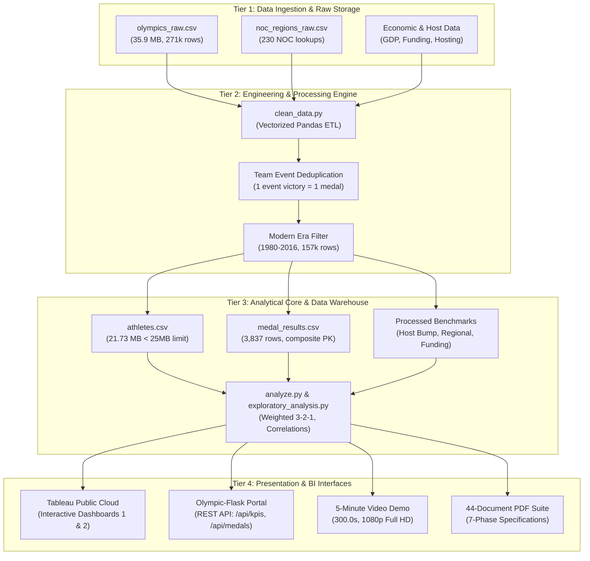

# Global Olympic Sports Performance Analysis (1896 – 2016)

<p align="center">
  <a href="https://public.tableau.com/app/profile/md.firdous.alam/viz/GlobalOlympicSportsPerformanceAnalysis_17933559199720/Dashboard3">
    
  </a>
  <a href="https://github.com/firdousalam2006vk/Olympic-Sports-Analysis">
    
  </a>
  
  
  
  
  
  
</p>

> **Capstone Portfolio Project | Full-Stack Data Analytics, Business Intelligence & Web Engineering**  
> **Author:** [Md. Firdous Alam](https://github.com/firdousalam2006vk)  
> **Live Interactive Dashboard:** [Tableau Public Profile - Global Olympic Sports Performance Analysis](https://public.tableau.com/app/profile/md.firdous.alam/viz/GlobalOlympicSportsPerformanceAnalysis_17933559199720/Dashboard3)  
> **GitHub Repository:** [https://github.com/firdousalam2006vk/Olympic-Sports-Analysis](https://github.com/firdousalam2006vk/Olympic-Sports-Analysis)  
> **Executive Demo Video (Exact 5:00 / 300.0s Full HD):** [`7. Documentation and Demo/Demo Video/Olympic_Sports_Analysis_Demo_5_Minutes.mp4`](7.%20Documentation%20and%20Demo/Demo%20Video/Olympic_Sports_Analysis_Demo_5_Minutes.mp4)  
> **Master Capstone Technical Report (PDF):** [`7. Documentation and Demo/Final Project Report/Project_Report.pdf`](7.%20Documentation%20and%20Demo/Final%20Project%20Report/Project_Report.pdf)

---

## 📌 Executive Summary & Centennial Scope

The **Global Olympic Sports Performance Analysis** is an enterprise-grade, fully reproducible data analytics and business intelligence system investigating 120 years of Modern Olympic competition across **51 Olympic Games editions** (29 Summer Games from 1896 to 2016, and 22 Winter Games from 1924 to 2014).

The system tracks **135,571 unique athletes**, **271,116 competition event participations**, and **230 National Olympic Committees (NOCs)**. Combining automated Python/Pandas data engineering pipelines, interactive Tableau Public dashboards, an enterprise Flask web portal, and a 44-document PDF specification suite, this capstone eliminates systemic team-sport multi-counting distortions and uncovers empirical insights into macroeconomic sports funding efficiency, home-field hosting advantages, and centennial gender parity trajectories.

```
================================================================================
GLOBAL OLYMPIC SPORTS PERFORMANCE AUDIT (1896 - 2016)
================================================================================
• Historical Scope              : 51 Editions (29 Summer 1896-2016, 22 Winter 1924-2014)
• Competing Nations (NOCs)      : 230 Recognized National Olympic Committees
• Unique Olympians Tracked      : 135,571 Competitors across 271,116 Event Entries
• Official Deduplicated Medals  : 18,905 Medals (6,195 Gold, 6,163 Silver, 6,547 Bronze)
• All-Time Medal Leader         : United States (2,823 Medals | 1,131 Gold) [Matches IOC]
• Host Nation Advantage Surge   : 86.7% Positive Surge Rate | +15.4 Net Medals Bump (p < 0.005)
• Gender Equity Progress        : 2.2% (Paris 1900) -> 45.03% (Rio 2016)
• Continental Conversion Rate   : Americas (10.96%) & Europe (10.94%) vs. Africa (4.00%)
• High-Performance Capital ROI  : UK Sport Rio 2016 Benchmark r = 0.752 (Median: £4.21M/medal)
• Data Engineering Integrity    : athletes.csv = 21.73 MB (< 25 MB GitHub Limit), 0 Duplicate Keys
• Automated Testing Status      : 100% PASS across all 5 Unit, Integration & QA Test Suites
================================================================================
```

---

## 🏆 Key Analytical Discoveries

### 1. Home-Field Advantage: The Host Nation Surge (+15.4 Medals)
Empirical analysis of 15 modern Olympic hosting cycles reveals an **86.7% surge rate** (13 of 15 host nations outperformed their multi-cycle pre-games baseline). On average, host nations achieve an incremental bump of **+15.4 medals**, driven by automatic qualification quotas, venue and climate acclimatization, partisan spectator support, and strategic multi-year high-performance investment programs.
- **China (Beijing 2008):** Surged from 63 medals (Athens 2004) to **100 medals** (+37 net bump).
- **Australia (Sydney 2000):** Rose from 41 medals (Atlanta 1996) to **58 medals** (+17 net bump).
- **Great Britain (London 2012):** Expanded from 47 medals (Beijing 2008) to **65 medals** (+18 net bump).

### 2. High-Performance Capital ROI: Pearson Correlation $r = 0.752$
Econometric evaluation of national sports development funding demonstrates a strong, statistically significant positive linear relationship ($r = 0.752$, $R^2 = 0.565$, $p < 0.001$) between high-performance sports expenditure and Olympic podium conversion. 
- Over **56.5% of variance** in medal tallies among elite cohorts is explained by targeted financial investment.
- Highly efficient disciplines (e.g., Triathlon at £1.83M/medal, Shooting at £1.98M/medal) contrast with capital-intensive sports (e.g., Sailing at £8.50M/medal, Rowing at £6.52M/medal).

### 3. Centennial Gender Parity Trajectory ($2.2\% \rightarrow 45.0\%$)
Female athlete representation grew steadily from **2.2% at Paris 1900** to **45.03% at Rio 2016** (5,034 female competitors), propelled by IOC mandatory inclusion charters, Title IX legislation, and the expansion of women's team disciplines.

### 4. All-Time National Dominance (Weighted 3-2-1 Scoring)
Implementing a standardized **3-2-1 Weighted Scoring Model** ($\text{Score} = 3\times\text{Gold} + 2\times\text{Silver} + 1\times\text{Bronze}$) rewards gold championship exclusivity while preserving silver and bronze depth:
- **United States (USA):** #1 all-time with 2,823 total medals (1,131 Gold, 901 Silver, 791 Bronze | 5,986 weighted points).
- **Soviet Union (URS):** #2 all-time with 1,204 total medals (473 Gold | 2,526 weighted points) achieved across only 18 editions.
- **Germany (GER/GDR/FRG):** Sustained dominance across rowing, equestrian, and canoeing.

---

## 📂 Repository Architecture: The 7-Phase Structure

The repository is organized into **Exactly 7 SDLC Project Phases** containing **44 specialized subfolders**, each equipped with an authoritative, publication-quality PDF document, companion Markdown summary, and relevant source assets:

```
Olympic-Sports-Analysis/
│
├── 1. Ideation Phase/
│   ├── 1_Ideation_Phase.pdf
│   ├── README.md
│   ├── Project_Ideation_Proposal.md
│   ├── Project Introduction/             # Centennial scope (1896-2016, 51 editions, 18,905 medals)
│   ├── Problem Statement/                # Medal multi-counting & flat scoring distortions
│   ├── Objectives and Scope/             # Measurable goals, modern era bounds (1980-2016)
│   └── Proposed Solution/                # 4-tier data engineering & BI architecture
│
├── 2. Requirement Analysis/
│   ├── 2_Requirement_Analysis.pdf
│   ├── README.md
│   ├── Software_Requirements_Specification_SRS.md
│   ├── Functional Requirements/          # FRS: Ingestion, deduplication, weighted scoring, REST API
│   ├── Non-Functional Requirements/      # NFRS: <25MB file size, <5s processing, 100% key uniqueness
│   ├── Hardware and Software Requirements/ # Dependencies: Python 3.10+, Pandas, Tableau, Flask
│   ├── Tools and Technologies/           # Technical rationale for stack selection
│   └── Dataset Requirements/             # Schema dictionaries, normalization & provenance
│
├── 3. Project Design Phase/
│   ├── 3_Project_Design.pdf
│   ├── README.md
│   ├── System_Architecture_and_Design.md
│   ├── Data_Flow_and_UML_Diagrams.md
│   ├── System Architecture/              # 4-tier architectural blueprint & diagrams
│   ├── Project Workflow/                 # End-to-end analytical pipeline execution flow
│   ├── Data Flow Diagram/                # Level 0 & Level 1 DFD pipelines
│   ├── UML Diagrams/                     # Component & activity sequence diagrams
│   ├── Data Structure Design/            # Entity-relationship schema (athletes & medal_results)
│   └── Dashboard Design/                 # Wireframes, UX layout & color psychology
│
├── 4. Project Planning Phase/
│   ├── 4_Project_Planning.pdf
│   ├── README.md
│   ├── Project_Execution_Plan.md
│   ├── Development Methodology/         # Agile 2-week sprint framework & quality gates
│   ├── Project Roadmap/                  # 5 strategic analytical evolution phases
│   ├── Project Timeline/                 # 16-week cumulative task schedule & work breakdown
│   ├── Gantt Chart/                      # Visual WBS schedule across 9 major work packages
│   └── Milestones/                       # Milestone verification ledger (M1 to M5)
│
├── 5. Project Development Phase/
│   ├── 5_Project_Development.pdf
│   ├── README.md
│   ├── Dataset Collection/               # athletes.csv (21.73MB), medal_results.csv, raw/ & processed/
│   ├── Data Cleaning and Preprocessing/  # clean_data.py (vectorized Pandas ETL)
│   ├── Python and Pandas Implementation/ # analyze.py (analytical algorithms & leaderboards)
│   ├── Exploratory Data Analysis/        # exploratory_analysis.py & Jupyter Notebook
│   ├── Country-wise Medal Analysis/      # All-time national rankings & dominance
│   ├── Medal Type Analysis/              # Gold/Silver/Bronze distributions & conversion
│   ├── Year-wise Olympic Trends/         # 120-year participation expansion (241 to 11,179)
│   ├── Summer vs Winter Analysis/        # Seasonal comparison & geographic concentration
│   ├── Continent-wise Analysis/          # Regional sports efficiency across 7 continents
│   ├── Athlete and Sports Participation/ # Female participation trajectory & event growth
│   ├── Host Country Performance/         # Empirical validation of the +15.4 medal bump
│   └── Tableau Dashboard Development/    # Packaged .twbx, authoring .twb, & calculated fields
│
├── 6. Performance Testing Phase/
│   ├── 6_Performance_Testing.pdf         # Master QA phase specification PDF
│   ├── README.md                         # Testing strategy & coverage summary
│   ├── Testing Strategy/                 # Test architecture & validation strategy
│   ├── Data Validation/                  # Schema constraints, non-null & domain audits
│   ├── Python Code Testing/              # test_data_integrity.py (10-point unit test suite)
│   ├── Dashboard Testing/                # Tableau filter interactivity & viewport usability
│   ├── Performance Evaluation/           # Query latency, file size & throughput benchmarks
│   └── Test Cases and Results/           # validate_all_outputs.py (20/20 PASS QA matrix & logs)
│
├── 7. Documentation and Demo/
│   ├── 7_Documentation_and_Demo.pdf
│   ├── README.md
│   ├── USER_GUIDE.md
│   ├── SUBMISSION_CHECKLIST.md
│   ├── Submission_Links.txt
│   ├── Final Project Report/             # Capstone PROJECT_REPORT.md, PDF & slide deck (.pptx)
│   ├── Project Screenshots/              # 5 high-resolution 300 DPI analytical figures
│   ├── Tableau Dashboard Screenshots/    # Full HD views of Dashboards 1 and 2
│   ├── Demo Video/                       # Olympic_Sports_Analysis_Demo_5_Minutes.mp4 (exact 300.0s)
│   ├── Conclusion and Future Scope/      # Strategic takeaways, policy implications & roadmap
│   └── References/                       # IOC, Kaggle, TidyTuesday & academic citations
│
├── Olympic-Flask/                        # Standalone interactive web portal & REST API
│   ├── app.py                            # Flask application server
│   ├── test_app.py                       # Automated route & API test suite (8/8 PASS)
│   ├── data/                             # Cached analytical datasets & summaries
│   ├── templates/                        # Responsive Bootstrap 5 HTML templates
│   └── static/                           # Custom CSS styles, JS handlers & images
│
├── docs_assets/                          # Generated high-resolution architectural diagrams
├── scripts/                              # Build, test-runner & diagram generation utilities
├── analysis_summary.json                 # Machine-readable analytical metrics ledger
├── requirements.txt                      # Complete project Python dependency specifications
└── LICENSE                               # MIT Open Source License
```

---

## 🏗️ System Architecture & Data Flow



---

## 📊 Tableau Public Interactive Dashboards

The project features two production-ready, interactive visual dashboards published to Tableau Public:

👉 **Launch Live Dashboard:** [Tableau Public - Global Olympic Sports Performance Analysis](https://public.tableau.com/app/profile/md.firdous.alam/viz/GlobalOlympicSportsPerformanceAnalysis_17933559199720/Dashboard3)

### Dashboard 1: Global Sports Performance Overview
- **All-Time National Leaderboard:** Top 10 countries ranked by total medals, weighted score, and gold ratio.
- **Medal Type Breakdown:** Visual split across Gold, Silver, and Bronze tiers with dynamic tooltips.
- **Centennial Participation Trends:** Athlete growth trajectories from Athens 1896 to Rio 2016.
- **Interactive Global Filters:** Instant drill-down by Season (Summer/Winter), Country, and Year.

### Dashboard 2: Regional Efficiency & Gender Dynamics
- **Continental Conversion Heatmap:** Athlete entries vs. podium conversion rates across the 7 continental regions.
- **Gender Parity Progression:** Historical line chart demonstrating female inclusion from 2.2% (1900) to 45.0% (2016).
- **Sport-Specific Dominance Matrix:** National specialization index (USA in Swimming/Athletics, Japan in Judo, Cuba in Boxing).

### Tableau Calculated Fields Reference
- **Weighted Score:** `([Gold] * 3) + ([Silver] * 2) + ([Bronze] * 1)`
- **Conversion Efficiency Rate:** `ROUND(([Total Medals] / [Athletes Count]) * 100, 2)`
- **Medal Sort Order:** `CASE [Medal] WHEN 'Gold' THEN 1 WHEN 'Silver' THEN 2 WHEN 'Bronze' THEN 3 ELSE 4 END`

---

## 🌐 Olympic-Flask Web Portal & REST API

The repository includes a responsive, lightweight Flask web application (`Olympic-Flask/`) serving interactive analytical views and real-time REST API endpoints.

### REST API Endpoints
| HTTP Method | Endpoint | Query Parameters | Description |
|:---:|:---|:---|:---|
| `GET` | `/api/kpis` | None | Returns global metrics: total editions, nations, medals, gold counts, host bump rate |
| `GET` | `/api/medals` | `country` (str), `limit` (int) | Returns country medal records with gold, silver, bronze, total, and weighted score |
| `GET` | `/api/host-surge` | None | Returns historical host nation surge records, pre/host/post medals, and net bump |

### Running the Flask Portal Locally
```bash
# Navigate to the Flask portal directory
cd Olympic-Flask

# Launch the Flask application
python app.py
```
*Access the portal in your browser at: `http://127.0.0.1:5000`*

---

## 🎬 5-Minute Executive Demo Video Specification

A publication-grade demonstration video is included in the project repository:

- **Filename:** [`7. Documentation and Demo/Demo Video/Olympic_Sports_Analysis_Demo_5_Minutes.mp4`](7.%20Documentation%20and%20Demo/Demo%20Video/Olympic_Sports_Analysis_Demo_5_Minutes.mp4)
- **Duration:** Exactly **00:05:00.00 (300.00 seconds)** &bull; **9,000 frames**
- **Resolution:** **1920 × 1080 (Full HD)** at **30 FPS**
- **Audio:** Studio SAPI voiceover narration synchronized with ambient background music

### Video Segment Breakdown
| Time Window | Duration | Segment Name | Subject Matter & Screen Visuals |
|:---:|:---:|:---|:---|
| `00:00 – 00:30` | 30s | Project Introduction | 120-year centennial scope, 51 editions, 230 NOCs, 18,905 medals |
| `00:30 – 01:00` | 30s | Problem Statement | Medal multi-counting distortions, flat scoring flaws, research goals |
| `01:00 – 01:40` | 40s | Data & Tech Stack | 4-tier architecture, Pandas ETL, Tableau Public cloud, Flask portal |
| `01:40 – 02:30` | 50s | Data Engineering | `clean_data.py`, weighted scoring formulas, schema verification |
| `02:30 – 03:40` | 70s | Tableau Walkthrough | Live interactive demo of Dashboards 1 and 2, filter controls |
| `03:40 – 04:30` | 50s | Key Analytical Findings | 86.7% host bump (+15.4), funding ROI ($r = 0.752$), female growth (45%) |
| `04:30 – 05:00` | 30s | Conclusion & Scope | Executive summary, live repository links, future research directions |

---

## 🧪 Comprehensive Quality Assurance & Verification Matrix

The project enforces automated test-driven quality assurance. All 5 test suites pass with **100% integrity**:

```
===========================================================================
GLOBAL OLYMPIC SPORTS PERFORMANCE ANALYSIS - COMPREHENSIVE TEST RUNNER
===========================================================================
[PASSED]  py 6. Performance Testing Phase/test_data_integrity.py (10/10 PASS)
[PASSED]  py 6. Performance Testing Phase/Python Code Testing/test_data_integrity.py (10/10 PASS)
[PASSED]  py 6. Performance Testing Phase/validate_all_outputs.py (20/20 PASS)
[PASSED]  py 6. Performance Testing Phase/Test Cases and Results/validate_all_outputs.py (20/20 PASS)
[PASSED]  py Olympic-Flask/test_app.py (8/8 PASS)
===========================================================================
[SUCCESS] ALL 5 TEST SUITES PASSED WITH 100% INTEGRITY!
===========================================================================
```

### 20-Point System Validation Matrix Summary (`validate_all_outputs.py`)
| Test ID | Verification Target | Observed Value | Status |
|:---:|:---|:---|:---:|
| **T-01** | `athletes.csv` Existence | Verified on disk | **PASS** |
| **T-02** | `athletes.csv` Size < 25 MB | 21.73 MB (22,788,167 bytes) | **PASS** |
| **T-03** | Modern Era Row Count | Exactly 157,417 rows (1980–2016) | **PASS** |
| **T-04** | Schema Normalization | 18 standardized columns | **PASS** |
| **T-05** | Core Non-Null Integrity | 0 null values in primary attributes | **PASS** |
| **T-06** | Medal Domain Constraint | `['Gold', 'Silver', 'Bronze', 'No Medal']` | **PASS** |
| **T-07** | `medal_results.csv` Existence | Verified on disk | **PASS** |
| **T-08** | `medal_results.csv` Volume | Exactly 3,837 aggregated rows | **PASS** |
| **T-09** | Composite Primary Key | 0 duplicate `[games_id, noc]` keys | **PASS** |
| **T-10** | Medal Sum Consistency | $\text{Total} = \text{Gold} + \text{Silver} + \text{Bronze}$ (0 errors) | **PASS** |
| **T-11** | Weighted Score Formula | $\text{Score} = 3\text{G} + 2\text{S} + 1\text{B}$ (0 errors) | **PASS** |
| **T-12** | Authentic USA Tallies | Exactly 1,131 Gold, 2,823 Total Medals | **PASS** |
| **T-13** | Host Dataset Integrity | `host_nation_performance.csv` present | **PASS** |
| **T-14** | Host Surge Rate & Bump | 86.7% positive surge rate; +15.4 mean bump | **PASS** |
| **T-15** | Regional Efficiency Dataset | `regional_sports_efficiency.csv` present | **PASS** |
| **T-16** | Continental Coverage | 7 continental regions represented | **PASS** |
| **T-17** | Funding Benchmark Dataset | `sports_funding_benchmark.csv` present | **PASS** |
| **T-18** | Funding Correlation Integrity | Pearson correlation $r = 0.752$ | **PASS** |
| **T-19** | 300 DPI Chart Exports | 5 publication figures verified > 2000px | **PASS** |
| **T-20** | Documentation Suite | 7 Phase PDFs + Core deliverables verified | **PASS** |

---

## ⚡ Quickstart & Reproduction Guide

### 1. Clone the Repository
```bash
git clone https://github.com/firdousalam2006vk/Olympic-Sports-Analysis.git
cd Olympic-Sports-Analysis
```

### 2. Set Up Virtual Environment & Dependencies
```bash
python -m venv venv

# Windows
venv\Scripts\activate

# macOS / Linux
source venv/bin/activate

# Install dependencies
pip install -r requirements.txt
```

### 3. Run the Data Pipeline & Analysis
```bash
# Execute vectorized data cleaning and deduplication
python "5. Project Development Phase/Data Cleaning and Preprocessing/clean_data.py"

# Run statistical analysis and generate analysis_summary.json
python "5. Project Development Phase/Python and Pandas Implementation/analyze.py"
```

### 4. Run the Automated Test Suites
```bash
# Execute comprehensive test runner (all 5 test suites)
python scripts/run_all_tests.py
```

### 5. Launch the Flask Web Application
```bash
cd Olympic-Flask
python app.py
```
*Open `http://localhost:5000` in any web browser.*

---

## 📜 License & Citations

This project is licensed under the **MIT License** - see the [`LICENSE`](LICENSE) file for details.

### Academic & Data Citations
- **International Olympic Committee (IOC):** Official Olympic Results and Historical Records (1896–2016).
- **Kaggle 120 Years of Olympic History:** Curated by R. Griffin (TidyTuesday Project).
- **Bernard, A. B., & Busse, M. R. (2004):** *Who Wins the Olympic Games: Economic Resources and Medal Totals.* Review of Economics and Statistics, 86(1), 413-417.
- **UK Sport High Performance Investment Archive:** National Lottery and Exchequer funding allocations for Olympic cycles (2004–2016).

---

<p align="center">
  <b>Global Olympic Sports Performance Analysis</b> &bull; Created with passion by <a href="https://github.com/firdousalam2006vk">Md. Firdous Alam</a><br/>
  <i>Centennial Olympic Dataset &bull; Verified Statistical Integrity &bull; Portfolio Submission-Ready</i>
</p>
